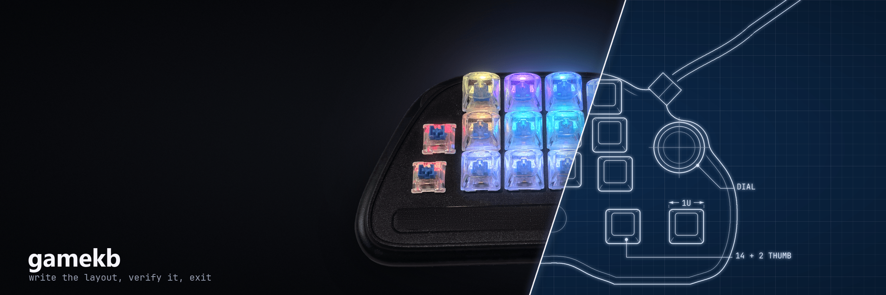
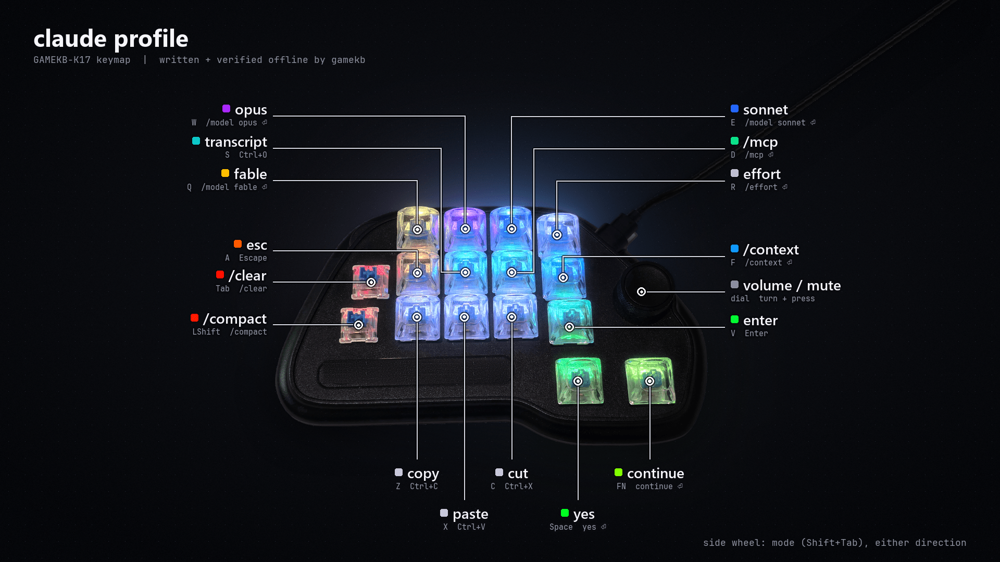

# gamekb-k17



Open-source configuration tool for the **GAMEKB-K17** macropad (model label **HCY-K017**, USB
`0816:0220`, SDCX / SDINNOVATION family): key remaps, firmware macros, per-key RGB and lighting,
written straight to the pad's flash.

Write a layout, verify it by reading it back, exit. The pad keeps everything in its own memory, so
after a write it works on any computer with no software running. No tray app, no background
process, no vendor web page.

```
> gamekb write -y claude
config: profiles/claude.json
3 change(s):
  macros: M0 'yes{Enter}' -> M0 'yes{Enter}', M1 'continue{Enter}'
  FN: factory -> macro M1
  FN: color #000000 -> #82ff00
  ...
done: 3 change(s) written, pad verified
```

> Not affiliated with the pad's maker or seller. Reverse-engineered from the vendor's web
> configurator; use at your own risk. gamekb only sends commands that were verified on hardware.

## Is this my device?

The GAMEKB-K17 is a one-handed gaming keypad with 14 keys, two thumb keys (Space, FN), a clickable
volume dial and a side wheel. It is sold unbranded under many names. Check the label and the USB
identity:

| | |
|---|---|
| Label on the back | `HCY-K017` |
| Embossed on the top plate | `KuaiJieJianPan` |
| USB ID | `0816:0220` |
| USB strings | manufacturer `SDCINNOVATION`, product `GAMEKB-K17` / `SD-Keyboard` / `SDMulti` |
| Vendor configurator | sdcx-tech.com (a WebHID page) |

Windows: Device Manager → the HID device → Details → Hardware Ids shows `VID_0816&PID_0220`.
Linux: `lsusb` shows `ID 0816:0220`. More in [docs/DEVICE.md](docs/DEVICE.md).

Other SDCX / SDINNOVATION pads probably speak the same protocol with different key positions. See
[Other devices](#other-devices).

## Features

- Remap 18 controls: all keys, both thumb keys and the side wheel. The dial is fixed in firmware.
- Firmware macros as plain text: `"macro": "git status{Enter}"`, with shortcuts, waits, capitals and
  symbols. Up to 16 macros.
- Per-key RGB colors, or built-in lighting effects with brightness and speed.
- **One-shot writes:** compares the pad with the config, sends only the differences, then reads
  everything back to verify. A re-run with nothing changed sends nothing.
- **Interruption-safe:** writes go in a safe order, so an unplug mid-write never leaves a key playing
  another key's macro. Re-run to finish.
- **Profiles:** keep several layouts as files and switch with `gamekb write NAME`.
- A small tkinter editor with a drawing of the pad. It touches the pad only when you press a button.
- Windows (tested) and other platforms with hidapi (untested).

The shipped `claude` profile, a layout for [Claude Code](https://claude.com/claude-code), on the pad:



## Install

Python 3.11 or newer.

```
git clone https://github.com/dvdarkin/gamekb-k17
cd gamekb-k17
pip install -e .
```

On Linux the configuration interface is root-owned by default. Either run with `sudo` or add a udev
rule for `0816:0220` (see the sdcx-keypad README for one).

## Use

```
gamekb detect              # is the pad reachable?
gamekb diff                # what would change (sends nothing)
gamekb write               # write config.json, confirm, verify
gamekb write -y claude     # write profiles/claude.json without asking
gamekb verify              # compare the pad with the config
gamekb read -o pad.json    # dump the pad's current layout as a config
gamekb profiles            # list profiles; '*' marks the one on the pad
gamekb reset               # restore the factory keymap (colors, lighting, macros kept)
gamekb gui                 # layout editor
```

Exit codes: 0 ok (also when you decline the prompt), 1 invalid config, 2 pad not found or bad
arguments, 3 write or verify failed (run it again to finish). `diff` exits 0 whether or not there
are differences.

A config is a JSON file:

```json
{
  "lighting": { "mode": "per-key", "brightness": 4 },
  "keys": {
    "A":     { "key": "Escape", "color": [255, 90, 0] },
    "S":     { "shortcut": "Ctrl+O" },
    "Space": { "macro": "yes{Enter}", "color": [0, 255, 0] }
  }
}
```

Full reference, including macro syntax and the shipped `claude` profile for Claude Code:
[docs/CONFIG.md](docs/CONFIG.md).

## Documentation

| | |
|---|---|
| [docs/CONFIG.md](docs/CONFIG.md) | Config format, macros, lighting, profiles |
| [docs/DEVICE.md](docs/DEVICE.md) | Hardware: identification, physical layout, what can be remapped |
| [docs/PROTOCOL.md](docs/PROTOCOL.md) | The reverse-engineered HID protocol: commands, keymap and color tables, lighting, macro format |
| [CONTRIBUTING.md](CONTRIBUTING.md) | Development setup, tests, adding hardware findings |

## Other devices

The GAMEKB-K17 belongs to a family of macropads configured through sdcx-tech.com. They share the
command set and differ in key layout.
[parsaj-dev/sdcx-keypad](https://github.com/parsaj-dev/sdcx-keypad) is a Linux driver for the
family (verified on the 6-key HCY-K006) and lists the USB IDs the vendor configurator accepts.
[docs/PROTOCOL.md](docs/PROTOCOL.md) marks which facts are verified on the K17 and which come from
that project. To support another layout, see [CONTRIBUTING.md](CONTRIBUTING.md).

## License

MIT. See [LICENSE](LICENSE).
