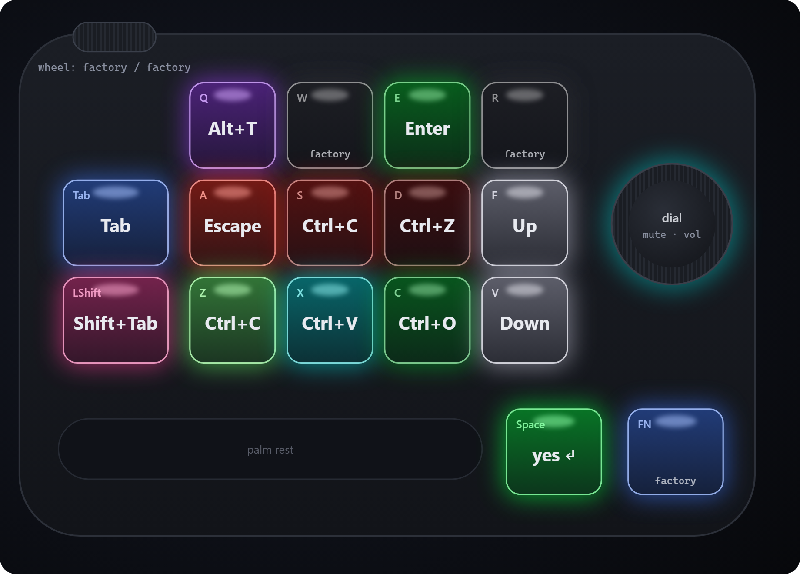
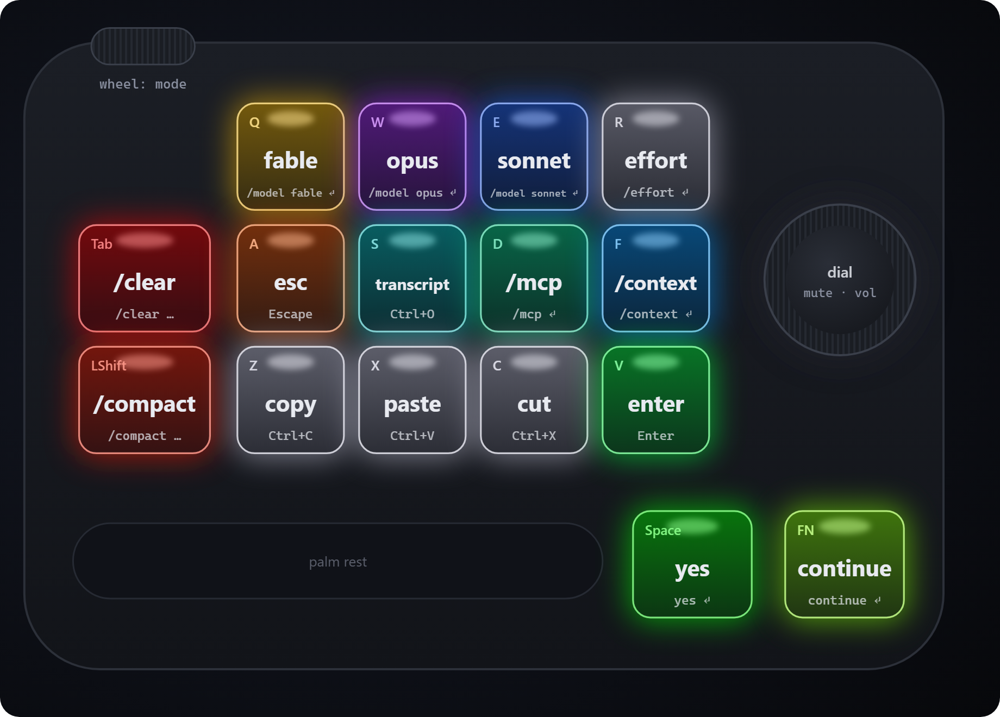

# Config reference

A config is a JSON file that describes the whole pad: what every key does, its color, and the
lighting. `gamekb write` makes the pad match it exactly. Anything the config leaves out goes back to
its factory value.

```json
{
  "lighting": { "mode": "per-key", "brightness": 4 },
  "default_color": [0, 0, 0],
  "keys": {
    "Q":     { "shortcut": "Alt+T", "label": "think", "color": [160, 60, 255] },
    "A":     { "key": "Escape", "color": [255, 90, 0] },
    "Tab":   { "media": "PlayPause" },
    "Space": { "macro": "yes{Enter}", "color": [0, 255, 0] },
    "Mute":  { "color": [40, 40, 50] }
  }
}
```

All errors in a file are reported together, before the pad is opened.

## Where configs live

- `gamekb write` with no argument uses `config.json` in the current directory, then the project
  root.
- `gamekb write path/to/file.json` uses that file.
- `gamekb write NAME` uses `profiles/NAME.json` when no file called NAME exists. If the current
  directory has a `profiles/` folder, that folder is used; otherwise the project's `profiles/`.

## Keys

Names: `Q W E R Tab A S D F LShift Z X C V Space FN Bright+ Bright- Mute Vol+ Vol-`.

Each key takes at most one action, plus optional `color` and `label`:

| Field | Value | Example |
|---|---|---|
| `key` | one key name (below) | `{"key": "Escape"}` |
| `shortcut` | modifiers + key, joined by `+` | `{"shortcut": "Ctrl+Shift+Z"}` |
| `media` | a media action (below) | `{"media": "PlayPause"}` |
| `macro` | text to type (see [Macros](#macros)) | `{"macro": "git status{Enter}"}` |
| `delay_ms` | gap after every macro event, 0–65535, default 20; only with `macro` | `{"macro": "hi", "delay_ms": 5}` |
| `color` | `[R, G, B]`, each 0–255 | `{"color": [0, 255, 60]}` |
| `label` | free text, shown in the editor | `{"label": "esc"}` |

- A key without an action gets its factory action. A key without a color gets `default_color`.
- **Mute, Vol+, Vol-** (the dial) take `color` and `label` only. The firmware ignores remaps there.
- Remapping **FN** removes the factory Fn layer (FN+Q profile switch, FN+R next effect).
- Labels live only in the file; the pad does not store them. The editor's "Read from pad" keeps the
  open file's label on every key whose action is unchanged.

### Key names

Letters `A`–`Z`, digits `0`–`9`, `F1`–`F24`, `Escape`, `Enter`, `Tab`, `Space`, `Backspace`,
`Delete`, `Insert`, `Home`, `End`, `PageUp`, `PageDown`, `Up`, `Down`, `Left`, `Right`, `CapsLock`,
`PrintScreen`, `ScrollLock`, `Pause`.

A key can also send a lone modifier: `LCtrl`, `LShift`, `LAlt`, `LWin`, `RCtrl`, `RShift`, `RAlt`,
`RWin`.

### Shortcuts

Modifiers `Ctrl`, `Shift`, `Alt`, `Win`, `RCtrl`, `RShift`, `RAlt`, `RWin`, then one key name:
`Ctrl+C`, `Alt+T`, `Ctrl+Shift+Escape`. Key names are spelled out (`Escape`, not `Esc`).

### Media actions

`Mute`, `VolumeUp`, `VolumeDown`, `PlayPause`, `Next`, `Prev`, `Stop`, `BrightnessUp`,
`BrightnessDown`.

## Macros

A macro types text using the pad's own firmware, with no software running.

```json
"Space": { "macro": "yes{Enter}" },
"D":     { "macro": "/mcp{Enter}" },
"W":     { "macro": "git status{Enter}", "delay_ms": 10 }
```

- Printable ASCII is typed with the US layout. Capitals and shifted symbols get LShift
  automatically.
- `{Name}` presses one key: `{Enter}`, `{Tab}`, `{Escape}`, `{F5}`, `{Up}`, any key name above.
- `{Mod+Key}` presses a shortcut: `{Ctrl+C}`, `{Ctrl+Shift+Z}`, `{Alt+Tab}`.
- `{wait N}` adds N ms after the previous event. Not allowed at the start or the end. The delay after
  any event (`delay_ms` plus waits) must stay within 65535 ms.
- `{{` and `}}` type literal braces. A JSON `\n` means `{Enter}`, `\t` means `{Tab}`.
- Up to 16 distinct macros and 4032 bytes in total. Each character costs 8 bytes (16 with Shift).
  Keys with the same macro text and delay share a slot.
- Macros are allowed on every key except the dial.
- A macro plays once per press and does not repeat while held. Use `key` or `shortcut` for anything
  you hold down.

`gamekb read` turns macros on the pad back into this syntax. Vendor-recorded macros with uneven
timing are normalized to their most common gap, with a warning.

## Lighting

```json
"lighting": { "mode": "per-key", "brightness": 4 }
"lighting": { "mode": "effect", "effect": "breath", "brightness": 3, "speed": 1 }
```

- `mode`: `per-key` shows the key colors; `effect` runs a built-in effect and hides them.
- `brightness`: 0–4, default 4. Only effects use it. Per-key colors always show at full strength
  (the firmware ignores brightness there), so dim a key by giving it a darker color.
- `effect` (effect mode only; an error in per-key mode): `off`, `static`, `breath`, `colorloop`,
  `stream`, `meteor`, `trigspread`. Default `static`.
- `speed` (effect mode only): 0–2, default 1.
- Effects use the firmware's color cycle. There is no effect color.
- `default_color`: the color of every key that has no `color`.

## Profiles

A profile is a config saved as `profiles/<name>.json`. The pad holds one layout at a time, so loading
a profile means writing it: only the differences are sent, then everything is verified.

```
gamekb profiles            # list profiles; '*' marks the one on the pad
gamekb write claude        # write profiles/claude.json
gamekb diff claude         # what writing it would change
gamekb gui claude          # edit it
```

Profile names start with a letter or digit and may contain letters, digits, `-` and `_`. In the editor, pick a profile from the Profile list
or use Save as profile.

Shipped profiles:

- `default`: a general layout (Alt+T, Enter, Escape, Ctrl+C/V/Z, arrows, `yes` + Enter on Space).

  

- `claude`: a layout for [Claude Code](https://claude.com/claude-code):

  

  ```
  [side wheel, top-left: either direction = mode (Shift+Tab)]
     Q            W           E             R
  /model fable  /model opus  /model sonnet  /effort
   Tab      A       S           D       F
  /clear   Esc   transcript    /mcp   /context
   LShift   Z       X           C       V
  /compact copy   paste        cut    Enter
                                 Space: yes + Enter   FN: continue + Enter
  ```

  `/clear` and `/compact` only type the command and wait for Enter (V), so a stray press does
  nothing destructive.

To draw a card like these for your own profile: `python tools/keymap_card.py NAME --png` (add
`--bare` for the pad only). It writes `docs/img/keymap-NAME[-bare].svg` and `.png`; PNG export needs
Chrome or Edge.
